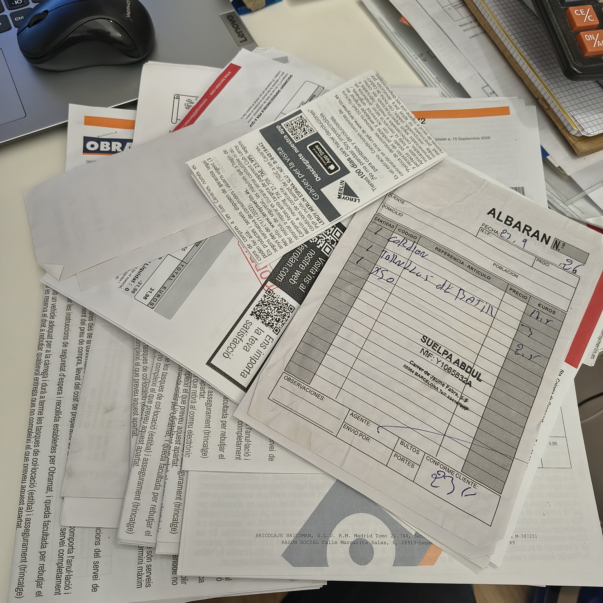

# How to follow your renovation and understand where the money goes

During a renovation, you want to know what has already been done, where the money has gone and how much will still be needed to finish.

Our clients receive free access to a private client area. There they can follow progress, see photographs, material expenses and payments made. Information is updated during the renovation, and cost changes can be compared with the initial estimate.

Behind these figures are specific purchases and decisions. Here is an example from a real renovation showing how they affect the calculation.

## Why adding up receipts is not enough

Five bags of tile adhesive at €14 each cost €70. That seems straightforward.

But the estimate specified one manufacturer and a different product was purchased. Is it a substitute for the same job? Was more material required? Or did the installation method change?

The answer determines how to revise the estimate. A substitution must update the original line item. A change in the work requires adding what is new and removing what is no longer needed. Otherwise, a purchase may be counted twice while a cancelled material remains in the final price.

Over several months of renovation, dozens of such changes can accumulate.

## The floor is levelled — time to update the calculation

The floor preparation originally included one self-levelling compound. In practice, two Capafloor products were purchased for different layer thicknesses: 16 bags of one and 6 of the other.

Materials for this work were already included in the estimate. The purchase therefore needs to be matched to the original item and the cost recalculated, while retaining the original figures for comparison.

Each receipt becomes part of the project record: what was bought, for which work and at what price. This includes large purchases as well as small expenses for primer, fittings or consumables.

Read more about floor preparation and costs in our [article on floor levelling before laying the covering](https://vitalvibeconstruction.com/en/articles/floor-leveling-before-covering/).

Every receipt forms part of the renovation cost, including purchases worth only a few euros.

## Decisions can increase or reduce the price

In this renovation, engineered parquet was selected instead of the SPC flooring initially planned. The floor covering cost increased by €1,847.72.

Other decisions reduced expenses. Removing the previously planned heating circuit took €472.05 in materials out of the calculation. The €400 allocated to wall preparation remained within the original scope and was not charged as an extra.

The estimate evolves with the project: new items are added, cancelled items are deducted, and planned prices are updated using actual purchases. In this case there were five versions. The original can still be consulted to explain the difference.

## When a detailed report is needed

At the client's request, we prepared a breakdown of the cost change. The initial estimate was €19,532.77, while the interim calculation as of 23 September 2026 was €23,144.40.

We explained the €3,611.63 difference by category: material substitutions, changes in work, deliveries and savings. Amounts still requiring verification or approval were identified separately. An interim calculation is not presented as a final price.

## What this means for you

Your private client area lets you check the state of the renovation without reconstructing its history from messages: completed work, photographs, expenses and payments.

If the cost changes, the discussion can begin with a specific purchase or change in scope. When needed, the same records can be used to prepare a detailed report.

Tracking also helps you look ahead: purchased materials are recorded at actual cost, while remaining purchases and work are included in the forecast. This helps you understand not only how much has been spent but also what may still be required to finish.

Example of the private client area: progress, expenses, payments and photographs in one place. The screenshot uses demonstration data.

## Related reading

- [Renovation costs in Barcelona: understanding the estimate](https://vitalvibeconstruction.com/en/articles/floor-leveling-before-covering/)
- [Painting walls: preparation and costs](https://vitalvibeconstruction.com/en/articles/wall-painting-price-preparation/)
- [Moving a bathroom basin: the work involved](https://vitalvibeconstruction.com/en/articles/moving-a-bathroom-basin/)
