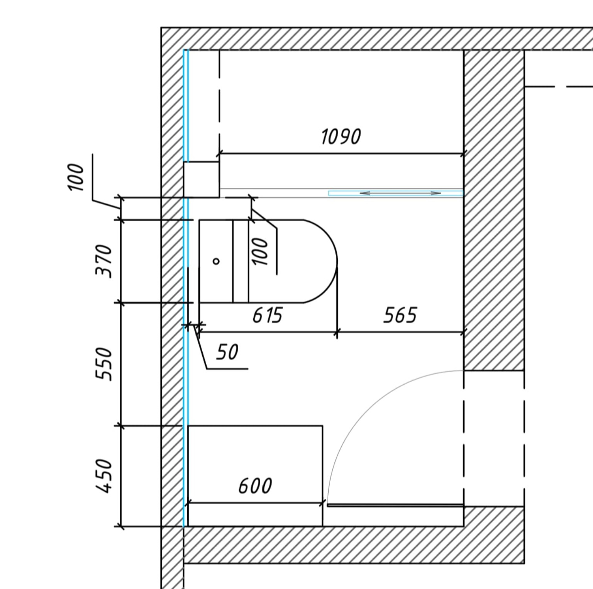
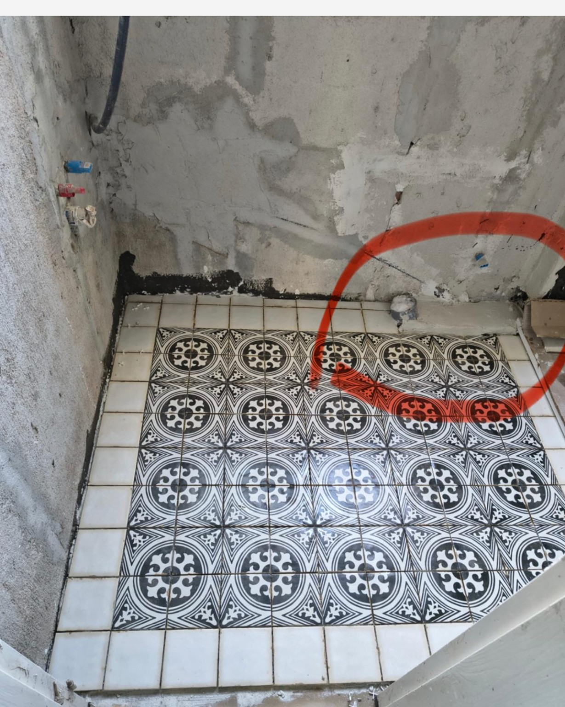

# Будущий контент

Здесь сохраняем идеи из работы, наблюдения и материалы, к которым стоит вернуться. Идея в этом списке не означает решение о публикации.

Это рабочие заметки репозитория. Репозиторий публичный: не добавлять данные клиентов, точные адреса, переписку и фотографии без согласования. Файл не включать в сайт, публичные таблицы контента и релизный пакет.

## Идеи

| ID | Тема | Статус | Следующий шаг |
| --- | --- | --- | --- |
| FC-001 | [Перенос унитаза на 15 см в готовом санузле](#fc-001) | Идея; публикация под вопросом | Исправить, зафиксировать результат, затем решить, рассказывать ли об этом |

## Как вести раздел

- Сначала записывать факты и исходную мысль владельца, затем отдельно — возможную подачу.
- Не превращать предположения в выполненные работы, обещания, отзывы или подтверждённые цифры.
- Статусы: идея → сбор материалов → черновик → готово к решению → опубликовано; можно отложить или отказаться.
- После публикации сохранять ссылку на материал; проверенный контент сайта оформлять через существующие `content/tables` и Knowledge Repository.
- Новые идеи добавлять с очередным ID. Номер FC — внутренний номер идеи, не номер статьи VVC-ART.

## FC-001. Перенос унитаза на 15 см в готовом санузле

**Добавлено:** 28 октября 2026.  
**Источник:** рассказ владельца в разговоре.  
**Статус:** идея; исправление ещё не подтверждено, решение о публикации не принято.  
**Возможный формат:** короткое видео или пост; при достаточном материале — статья.

### Что известно со слов владельца

- Ремонт квартиры начали давно, затем объект заморозили.
- Клиент вернулся с немного доработанным планом.
- Унитаз установили по старому выводу канализационной трубы.
- Сейчас его нужно сместить на 15 см; санузел уже готов.
- Предварительная оценка владельца — два дня работы. Это не фактический срок завершённой переделки.
- Владелец признаёт ошибку команды и рассматривает, можно ли превратить этот опыт в полезный материал.

### Исходная мысль и сомнение

Владелец замечает, что ремонтники иногда показывают свои ошибки. При этом есть опасение, что зрители воспримут рассказ как свидетельство некомпетентности: «скажут — рукожопы».

Сохранить это сомнение при подготовке материала. Публикация необязательна; к решению вернуться после исправления.

### Возможная подача — пока гипотеза

Рабочая тема: **«15 сантиметров, из-за которых приходится переделывать готовый санузел»**.

Показать последовательность: что произошло → как выбрали способ исправления → что переделали → как восстановили отделку → что изменили в проверке актуальных планов.

Заморозка объекта и обновление плана — контекст. Не использовать их, чтобы перекладывать признанную ошибку на клиента. Не обещать, что такой рассказ обязательно повысит доверие.

### Полученные материалы

28 октября 2026 владелец приложил план и фотографию. Оригиналы сохранены без изменения изображения в `task/media/fc-001/`.

**План санузла** — исходное имя `1000007126.jpg`. На схеме показаны расположение сантехники и размеры. Какая это редакция плана — старая или обновлённая — пока не уточнено.

**Фото с отмеченным выводом канализации** — исходное имя `1000007125.jpg`. Видны плиточный пол, стены без финишной отделки и вывод у стены, отмеченный красным кругом. Точный этап и дата съёмки не уточнены; это не фото готового санузла и не результат переноса.

По этим изображениям нельзя подтвердить фактическое смещение на 15 см или завершение исправления. Для истории ещё нужны актуальное фото готового санузла до переделки и кадры после исправления.

### Что собрать и уточнить

- [x] Получить от владельца план и фото с отмеченным выводом канализации.
- [ ] Уточнить редакцию плана и этап съёмки фотографии.
- [ ] Согласовать с клиентом съёмку и возможную публикацию.
- [ ] Снять исходное положение и замер без данных, позволяющих узнать клиента или адрес.
- [ ] Зафиксировать выбранный способ переноса и фактический объём переделки.
- [ ] Снять процесс и восстановленную отделку, общий вид результата.
- [ ] Записать фактические сроки и затраты; уточнить, кто оплачивает исправление.
- [ ] Подтвердить, какое правило сверки планов команда действительно ввела.
- [ ] После завершения решить: публиковать, отложить или оставить только рабочей заметкой.

### Что пока нельзя утверждать

Исправление за свой счёт, конкретный способ переноса, завершение за два дня, успешный результат, реакция клиента и новое правило контроля пока не подтверждены. В разговоре часть этих действий была предложена как вариант, а не сообщена владельцем как свершившийся факт.

## Шаблон следующей идеи

- **ID и тема:**
- **Дата и источник:**
- **Статус:**
- **Факты / исходная мысль владельца:**
- **Чем это полезно читателю:**
- **Возможная подача и формат:**
- **Материалы и недостающие сведения:**
- **Сомнения и условия публикации:**
- **Следующий шаг:**
- **Ссылка на опубликованный материал:** после публикации.
